<div align="center">

# ReMarks

**适用于 Chrome、Edge 与 Firefox 的 AI 辅助书签整理扩展**

先生成可审核的分类建议，再由你确认移动；每次批量改动前都会创建本地备份。忘记网站名字时，也可以直接按“它大概是做什么的”来搜索书签。

[](https://github.com/waangzh/re-bookmarks/releases/tag/v2.0.0)


[核心能力](#-核心能力) · [印象搜索](#功能印象搜索) · [偏好学习](#分类偏好无感学习) · [安装](#-安装与体验) · [使用流程](#-使用流程) · [隐私与权限](#-隐私与权限) · [本地开发](#-本地开发)


</div>

## 为什么是 ReMarks

书签越多，整理成本越高；直接把批量移动交给 AI，又很难放心。

ReMarks 在两者之间提供了一条可控路径：读取浏览器书签树，结合本地规则、已经学到的分类偏好与 OpenAI-compatible AI 服务生成建议；你可以先确认分类框架，再检查代表条目、异常变更、模型信号和分类原因，手动调整预览结果，确认后才会真正移动书签。每次明确修正也会成为后续分类的参考，不需要手动维护 Prompt。

| 可控整理 | 安全回退 | 隐私最小化 |
| --- | --- | --- |
| AI 只生成建议，不会静默批量移动 | 整理、推荐移动、导入和批量删除前自动备份 | URL 默认移除 query/hash 后再发给 AI |
| 预览可拖动调整；忽略建议不会记录偏好 | 支持撤销或重新应用最近一次整理 | 浏览历史仅本地统计，且权限默认不开启 |
| 删除、恢复等敏感操作需要再次确认 | 最多保留 5 份近期备份并支持安全恢复 | API Key 仅保存在 `chrome.storage.local` |


## 🖼️ 界面预览

截图展示当前源码界面；图中的书签标题、网址、目录、数量、模型名称与执行记录均为示例数据。

| 首页：下一步建议与常用操作 | 展开「更多工具」快速跳转 |
| --- | --- |
| 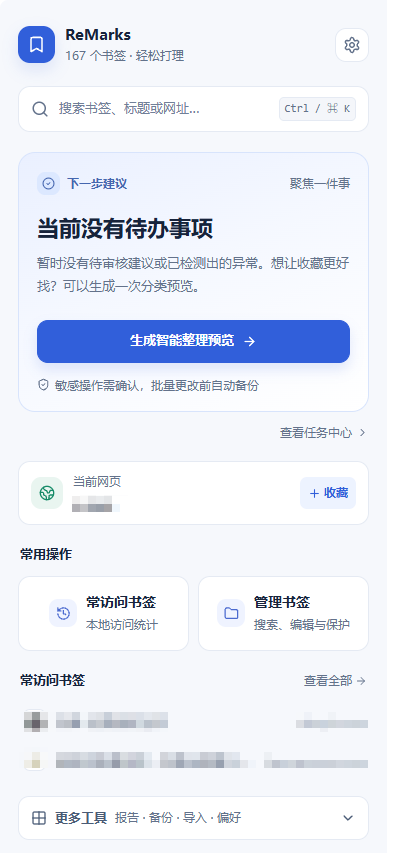 | 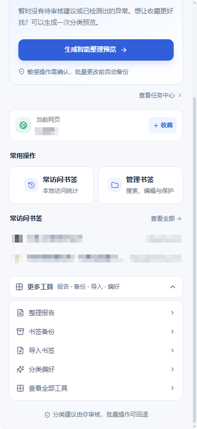 |

| 更多工具页 | 选择书签与本次模型 |
| --- | --- |
| 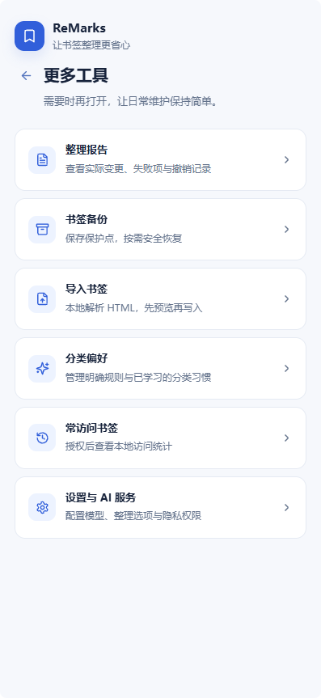 | 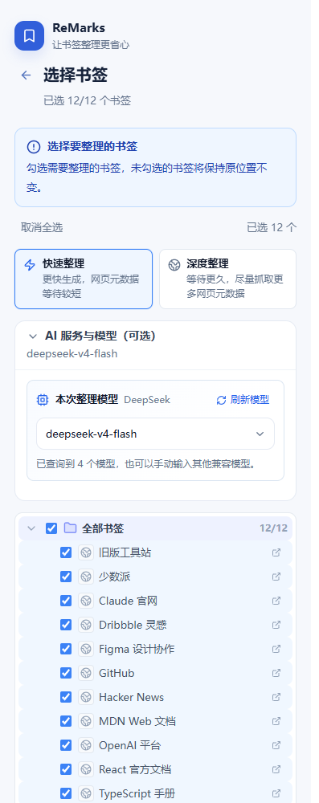 |

| 管理书签与白名单 | 备份与安全恢复 |
| --- | --- |
| 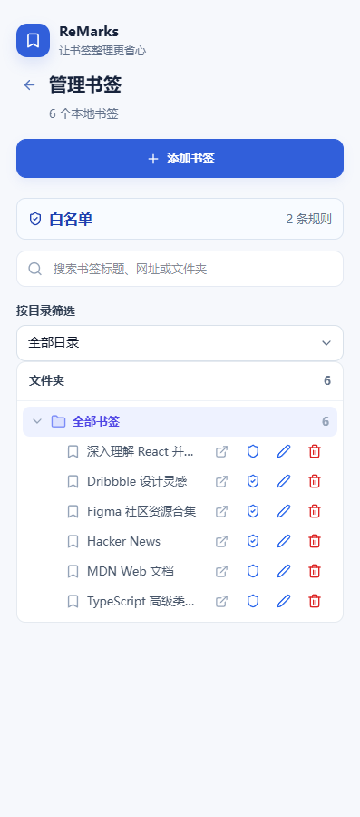 | 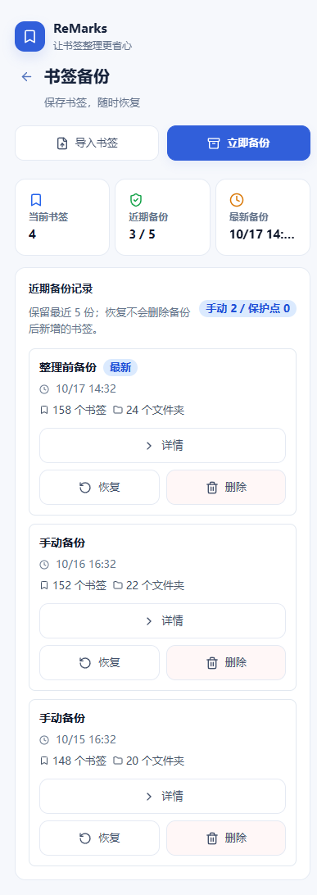 |

<details>
<summary>查看更多：整理报告、分类偏好与日常维护</summary>

| 整理报告 | 分类偏好管理 |
| --- | --- |
| 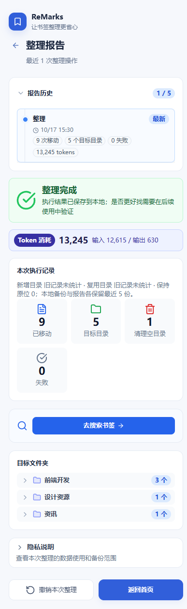 | 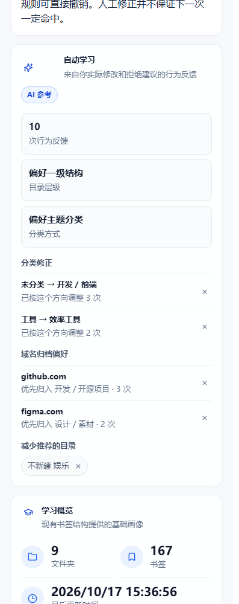 |

| 常访问书签 | 失效链接检测 |
| --- | --- |
| 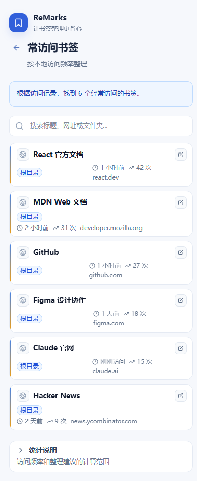 | 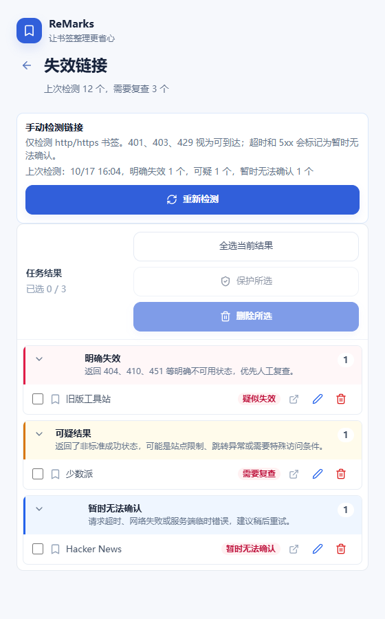 |

</details>

## ✨ 核心能力

### 首次引导与可修正小样本

- 首次打开会先在本地统计书签、未分类项、疑似重复和现有文件夹，不会上传浏览历史。
- 选择自定义 Provider 时，可直接填写 API Key、Base URL、模型及兼容参数，再测试连接，无需先进入设置页。
- 测试 AI 连接并主动授权数据发送后，从不同目录抽取最多 20 个书签生成试分类，并展示其中最多 5 条供逐项检查。
- 每条代表建议会显示分类理由和相对把握程度；可在当前页面直接改写目标目录，修改后的目录结构和修正数量会即时更新。
- 可以只应用页面中已经检查的条目：执行前仍会创建完整备份，未展示的样本不会随之移动；也可以先保存明确修正，再进入完整预览。
- 没有 API Key 时，可通过“先使用本地搜索与重复检查”进入本地功能；本地功能印象搜索不依赖 AI，之后仍可在设置页连接 AI。

### 首页任务中心与工具导航

- 首页顶部先给出“下一步建议”：按待审建议、重复链接、失效链接、未分类等优先级，聚焦当前最该处理的一件事；没有待办时提供生成分类预览的入口。
- 搜索框可直接按标题、URL、目录或功能印象查找书签，支持 `Ctrl / ⌘ K` 唤起。
- “当前网页”卡片显示本页是否已收藏，并提供一键收藏入口。
- “常用操作”固定两个高频入口：第一个随当前状态切换为智能整理、继续审核整理方案或常访问书签，第二个始终是书签管理；下方列表在授权历史后显示常访问书签，否则显示最近收藏。
- 底部“更多工具”可展开，直接进入整理报告、书签备份、导入书签与分类偏好，并可跳转到完整工具列表页，其中包含常访问书签与设置。
- 从工具页返回首页时会恢复离开时的滚动位置与“更多工具”展开状态，无需重新定位。

### AI 辅助整理

- 读取并按文件夹选择浏览器书签，支持快速整理与深度整理。
- 结合书签标题、域名、现有路径和可获取的网页元数据生成分类建议。
- 支持 OpenAI、DeepSeek、智谱 GLM、Kimi、Gemini、MiniMax、通义千问、豆包及自定义 OpenAI-compatible 端点。
- 每个 Provider 独立保存配置；设置页和整理页使用当前 API Key 与 Endpoint 查询模型列表，在同一输入框中选择或手动填写模型，支持刷新列表。
- 模型检测失败或服务商不提供列表时，仍可手动输入；列表中的模型是否能用于分类，需要继续测试连接。
- 可限制一级分类数量、嵌套层级与子分类数量，并通过已学习的分类偏好保持命名和粒度一致。

### 分类偏好无感学习

ReMarks 把“分类习惯”作为贯穿推荐、预览和书签管理的学习机制，而不是要求用户先配置一套 AI 规则。

- 当用户把 AI 建议的 A 分类改为 B、拖拽到其他目录、手动移动书签，或明确选择“不推荐这个分类”时，才会记录反馈。
- “忽略建议”只会移除当前建议，不记录 `folder_rejected`；批量忽略也遵循相同语义。
- 学习内容包括“原分类 → 修正分类”、域名常用目录、明确拒绝的新目录或域名分类，以及一级/二级结构和主题/用途分类倾向。
- 修改后显示轻量反馈，例如：`已记住：github.com 的书签优先归入“开发 / 开源项目”`。
- 下一次调用 AI 分类时，会把累计修正、域名偏好和拒绝规则作为高优先级上下文注入分类提示；层级和分类风格累计至少两次后才参与判断，减少偶然操作造成的误学。
- “分类偏好”页面用于查看、删除、导入和导出 ReMarks 已经学到的内容；手动 Prompt 与规则编辑保留在高级设置中。
- 可主动“更新书签画像”，重新分析现有目录和脱敏书签样例，补充整体偏好、常用一级分类与文件夹规则；连接并授权 AI 后会调用所选 Provider，未配置、未授权或分析失败时使用本地规则推断。
- 学习结果是对 AI 的软约束，不会绕过预览、确认、备份或直接在本地强制移动书签。

### 预览、确认与报告

- 按目标文件夹展示移动计划、模型信号、分类原因和 token 用量；模型信号只用于相对排序，不代表经过校准的正确率。
- 复用现有目录、符合已有习惯且不跨一级目录的建议可抽查，无需逐项审核。
- 拟新增的一级目录先作为分类框架确认；采用后，再按目标目录查看强、典型、弱三个代表条目并决定是否接受该组。
- 跨一级目录、疑似重复或模型依据较弱的变更仍需逐项决定，不提供整组批准。
- 可在预览中长按拖动书签，手动修正 AI 建议；确认前不会改动书签。
- 确认后复用或创建目标文件夹，逐条移动并记录失败项。
- 报告把移动数、涉及的目标目录和空目录清理数明确标为“执行记录”，不把操作数量解释为整理价值。
- 整理后可直接进入现有书签搜索，实际验证是否更容易找回内容；当前不会据此宣称找回率或节省时间已经提升。
- 整理时生成的功能印象词会写入本地印象索引，后续可按“功能”而不只是标题找回书签。
- 保留最近 5 次整理报告；最新一次整理可撤销，也可在不重新调用 AI 的情况下重新应用。

### 书签白名单保护

- 在“管理书签”中，可将单个书签或文件夹加入白名单；文件夹保护会覆盖其中现有及后续新增的子项。
- 受保护项目会跳过智能整理、分类推荐、清理删除和链接检测；自动整理也不会将书签移入受保护目录。
- 白名单不影响搜索、打开和完整备份。可在管理页搜索、定位或解除保护；备份恢复时会迁移因恢复而变化的书签 ID，保留对应保护规则。

### 日常书签维护

- 新增书签后生成待处理推荐，可编辑目标分类、接受、忽略或批量处理；“不推荐这个分类”作为独立的明确负反馈。
- 聚合待手动归档、重复链接和失效链接任务；不需要处理的手动归档项可单个或批量忽略。
- 重复检测区分精确重复、忽略 query/hash 后的同路径疑似重复和标题相似疑似重复。
- 失效检测区分明确失效、可疑和暂时无法确认；401、403、429 不会被直接判定为失效。
- 支持搜索、新增、编辑、删除、拖拽移动书签，以及批量清理重复或失效项。
- 可选读取最近 90 天浏览历史，仅在本地统计已收藏 URL 的访问频次。

### 功能印象搜索

忘掉名字也能找回书签。ReMarks 会为书签建立“功能印象索引”，记录它大概是做什么的，而不只是标题和网址。

**本地印象搜索（V1）**

- 输入「看视频的网站」「图片压缩」这类功能描述，即可匹配标题、AI 功能印象词、所在目录、AI 功能简述、站点类型与 URL。
- 自动剥离「那个 / 好用的 / 网站 / 工具」等口语词并拆出中文双字词，尽量理解自然表达。
- 内置常见站点词典与域名特征识别，尚未跑过 AI 整理的存量书签也能被搜到。
- 每条命中都会说明原因，例如 `✨ 匹配功能印象：图片压缩 / 图像优化`、`✨ 站点类型识别：视频网站`。
- 完全本地执行，不调用 AI，不消耗 Token。

**AI 深度回忆（V2）**

当本地检索想不出来时，在搜索框按 `Tab`（或 `Ctrl / ⌘ + Enter`）触发 AI 深度回忆：

1. **意图联想**：AI 把模糊描述翻译成核心意图词、中英文词根、可能匹配的站点名与可能所属目录。这一步不发送任何书签数据。
2. **本地宽网召回**：用联想结果扫描全量书签，几千条也只需毫秒级；命中推测站点的书签会直接排到前面，即使它从未整理过。列表此时已立即刷新。
3. **候选精排与索引自愈**：只把前 25 个候选的精简信息（标题、域名、一级路径、所在目录）发给 AI 精排，返回 `🎯 AI 深度匹配` 理由；同时为尚未建立印象的书签顺手补全功能词并写回本地索引。

搜索框下方用联想词胶囊展示 AI 的理解结果，搜索结果旁标注 `⚡ 已记住该印象`，表示下次用本地搜索就能直接命中。同一次会话内重复搜索相同描述会复用联想结果，不重复消耗 Token。

**建立印象索引**

- 批量整理、新书签推荐、手动调整目录时，会自动顺带写入功能印象。
- 管理页顶部显示索引覆盖率，并提供 `补全剩余 N 个书签印象` 按钮，仅针对未索引书签分批调用 AI。
- 补全会按批次即时落盘：中途停止或关闭窗口后，已完成的批次会保留，下次点击从剩余书签继续。
- 补全只写入本地索引，不移动、删除或改写任何书签，也不创建备份或整理报告。

### 导入与备份

- 导入浏览器导出的 Netscape bookmarks HTML 文件，先预览，再写入新的导入文件夹。
- 自动跳过重复和无效条目，并保留原始目录层级。
- 整理、导入、恢复、重复删除和失效删除前创建保护点。
- 支持手动备份、查看最近 5 份记录，并展开文件夹详情核对内容；安全恢复前会再次备份当前状态。
- 安全恢复不会删除备份之后新增的书签。

## 🚀 安装与体验

### 从 Release 安装

> README 以 `master` 当前源码为准；Release 压缩包对应其版本标签中的代码与发布说明。

### Chrome / Edge

1. 前往 [最新 Release](https://github.com/waangzh/re-bookmarks/releases/latest) 下载 `re-bookmarks-v*.zip`。
2. 解压压缩包。
3. 打开 `chrome://extensions` 或 `edge://extensions`。
4. 开启“开发者模式”，点击“加载已解压的扩展程序”。
5. 选择解压后包含 `manifest.json` 的文件夹。

### Firefox

1. 如果对应 Release 附带 Mozilla 已签名的 `re-bookmarks-firefox-v*.xpi`，在 Firefox 中打开该文件并确认安装。
2. Firefox 140.0 以下不支持此版本。
3. 未签名的 `dist-firefox/` 仅用于开发调试，可在 `about:debugging#/runtime/this-firefox` 临时加载。

签名 XPI 依赖 AMO 凭据；签名、最低版本和回归步骤见 [Firefox 构建、测试与签名](docs/firefox-release.md)。


### 从源码构建

环境要求：

- Node.js 22（与发布工作流一致）
- pnpm 10.25.0
- Chrome、Edge 或 Firefox 140+

```bash
git clone https://github.com/waangzh/re-bookmarks.git
cd re-bookmarks
pnpm install
npm run build:all
```

Chromium 产物在 `dist/`；Firefox 开发产物在 `dist-firefox/`。Firefox 正式安装前还需要 Mozilla 签名，命令见 [Firefox 构建、测试与签名](docs/firefox-release.md)。

## 📖 使用流程

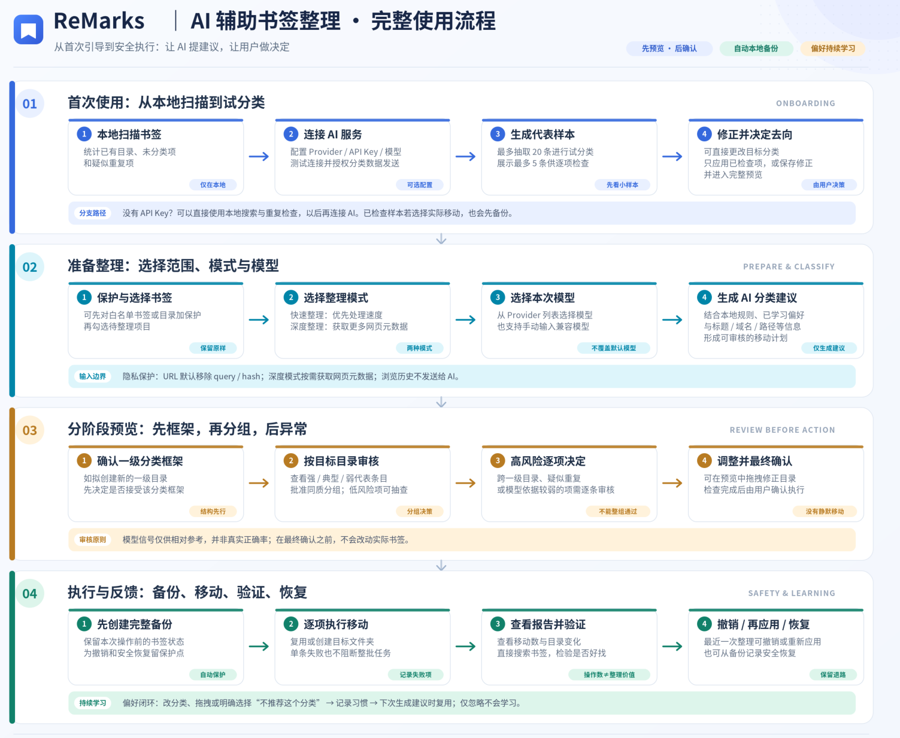

1. **首次使用**：本地扫描书签 → 连接 AI → 生成最多 20 个代表样本，当场修正其中 5 条。没有 API Key 时可直接使用本地搜索与重复检查。

2. **准备整理**：保护需要保持原样的书签或文件夹，选择快速或深度整理，确认本次模型。本次选择不会覆盖设置页的默认模型。

3. **分阶段预览**：先确认一级分类框架，再按目录审核代表条目，高风险变更逐条决定。确认前不会改动任何书签。

4. **执行与恢复**：先完整备份，再逐条移动，单项失败不中断整批。之后可查看报告、搜索验证，或撤销、重新应用、从备份安全恢复。

## 🔐 隐私与权限

### 会发送给 AI 的数据

完成 Provider 测试后，还需要主动开启“允许向此服务发送分类数据”。开启后，分类请求才可能包含书签标题、域名、现有文件夹路径、URL，以及深度整理时获取到的页面标题、描述等元数据。

- 默认情况下，URL 会移除 query 和 hash。
- 只有主动开启“发送完整 URL”后，才会发送完整 URL。
- 分类偏好保存在 `chrome.storage.local` 的 `remarks.folderHabitProfile` 中；生成下一次分类请求时，其中的分类修正、域名到目录的映射和拒绝规则可能作为提示上下文发送给所选 AI Provider。
- 功能印象索引保存在 `remarks.semanticIndex`，仅存于本地；AI 深度回忆时只发送候选书签的精简信息（标题、域名、一级路径、所在目录、已有摘要），不发送完整书签库。
- AI 深度回忆的第一步（意图联想）只发送你输入的搜索描述，以及最多 30 个现有目录名称，不含任何书签。
- 主动“更新书签画像”时，也会向已配置的 AI Provider 发送目录结构与脱敏书签样例，用于分析分类习惯。
- 浏览历史不会进入 AI 请求。
- 实际数据还会受所选 AI Provider 的隐私政策约束，请使用你信任的服务。

### 浏览器权限说明

| 权限 | 用途 |
| --- | --- |
| `bookmarks` | 读取书签树，以及在确认后创建文件夹、移动、编辑、删除或恢复书签 |
| `storage` | 在本地保存设置、推荐、预览任务、报告和备份 |
| `activeTab` | 在侧边栏显示当前网页是否已收藏及相关书签 |
| `favicon` | 仅 Chrome / Edge：显示书签网站图标；Firefox 使用本地图标降级显示 |
| `sidePanel` | 仅 Chrome / Edge：点击扩展图标时打开 ReMarks 侧栏；Firefox 使用原生 `sidebar_action` |
| `<all_urls>` | Chrome / Edge 在安装时授予；Firefox 在测试 AI、开始 AI 整理、AI 深度回忆、重试推荐或启动链接检测时按需请求，用于自定义 AI endpoint、网页元数据和失效链接检测 |
| `history`（可选） | 用户主动开启后，仅在本地统计常访问的已收藏网页 |

`history` 保持为 optional permission：未开启常访问书签时不会请求，拒绝或撤销授权会关闭该功能，但不影响核心整理功能。Firefox 拒绝或撤销网站访问权限时，AI、网页元数据和链接检测会降级并提示重新授权；本地书签浏览、备份和手动管理保持可用。完整说明见[隐私说明](docs/privacy-policy.md)。

## ⚙️ AI Provider

内置 Provider 预设会自动处理常见 Endpoint、temperature、token 参数名与 JSON mode 差异，也可以使用自定义 OpenAI-compatible 服务。

| Provider | 配置项 |
| --- | --- |
| OpenAI / DeepSeek / 智谱 GLM / Kimi | API Key、模型、Endpoint 与高级参数 |
| Gemini / MiniMax / 通义千问 / 豆包 | 对应兼容端点、模型与 Provider 参数适配 |
| Custom | 自定义 OpenAI-compatible Endpoint、模型及请求参数 |

自定义服务的 Base URL 填服务商提供的接口根地址（通常以 `/v1` 结尾）；ReMarks 会自动追加 `/chat/completions`。首次引导和设置页均可调整 Temperature、Max tokens、Token 参数与 JSON mode，以适配服务商要求。

设置页可“检测可用模型”，整理页可“刷新模型”；检测结果支持选择，也保留手动输入。修改 API Key、Endpoint 或默认模型后，需要重新测试连接；模型列表可见不代表当前账号一定能调用该模型。

模型列表会按 Provider 类型与 Endpoint 本地缓存 24 小时：重新打开设置页时优先展示缓存并标注更新时间，点击“检测可用模型”可强制刷新；检测失败时会降级展示上次缓存的列表。缓存仅保存模型 ID 与归属信息，不包含 API Key。各 Provider 的列表接口依据、超时与失败处理见 [模型列表检测](docs/model-discovery.md)。

如果未配置 API Key，浏览、管理、导入、备份以及本地功能印象搜索仍可使用，但无法生成 AI 分类建议、AI 深度回忆或补全印象索引。

## 🛠️ 本地开发

```bash
# 监听 Chromium 开发构建
npm run dev

# 生成 Chrome / Edge 可加载产物
npm run build

# 生成 Firefox 可加载产物
npm run build:firefox

# 同时构建两个目标
npm run build:all
```

监听构建只覆盖 Chromium；Firefox 调试需重新执行 `npm run build:firefox`，并在浏览器扩展管理页重新加载。项目没有独立的 lint、typecheck 或单元测试脚本；代码变更至少应通过 `npm run build:all`，涉及界面时还应手动检查 360px popup、侧边栏和设置页。

### 技术栈

- Manifest V3
- React 18 + TypeScript
- Vite 6 + Tailwind CSS v4
- Zustand + React Router
- Radix UI + lucide-react
- 书签、存储、权限与可选历史记录 WebExtension API

### 项目结构

```text
src/
  app/
    components/    页面组件：整理、报告、推荐、备份、导入、书签管理等
    hooks/         跨页面复用的交互状态机，例如 AI 深度搜索
    services/      书签、AI、印象搜索、偏好学习、规则、整理、备份、历史和存储等业务逻辑
    store/         Zustand 全局状态
    types.ts       跨模块业务类型
    App.tsx        popup、side panel 与 options 共用路由
  background/      Chromium service worker 与 Firefox background scripts 共用逻辑
  popup/           360px 紧凑页面入口
  sidebar/         Chromium side panel 与 Firefox 原生侧栏入口
  options/         设置页入口
  styles/          Tailwind 入口与全局样式
scripts/           Manifest 后处理与图标生成脚本
public/icons/      扩展图标
manifest.json      Chromium 开发态扩展清单
manifests/firefox.json  Firefox 开发态扩展清单
docs/              隐私说明与 Firefox 构建、测试、签名指南
```

## 📌 当前状态与限制

- `package.json`、Chromium 与 Firefox 清单当前版本均为 `2.0.0`；Chrome、Edge 与 Firefox 共用业务代码，通过独立清单和构建产物适配浏览器差异。
- 标签发布工作流会校验 Firefox 产物，并在配置 AMO 签名凭据时生成可安装的 unlisted XPI；未签名产物只用于开发调试。
- AI 结果可能不准确，尤其是标题含糊或页面元数据不可访问时；请始终检查预览。
- 分类偏好当前通过高优先级 Prompt 影响 AI，而不是本地硬路由；模型仍可能不完全遵循，所以学习机制不会替代人工确认。
- 一级/二级目录和主题/用途倾向基于用户修正次数与目录名称启发式判断，少量反馈只会保留为记录，不会立即形成全局偏好。
- 深度整理单次最多建议选择 100 个书签；快速整理建议单次不超过 300 个，较大书签库应按文件夹分批处理。
- 印象搜索的本地检索始终可用；AI 深度回忆每次会产生 2 次 AI 请求（意图联想 + 候选精排），补全索引按批次产生请求，均需自行承担相应费用。
- 印象索引以规范化 URL 为主键，书签改名或移动目录后仍可复用；彻底删除书签后索引记录不会自动清除，但不影响搜索。
- AI 深度回忆与索引补全依赖模型判断，可能漏检或误判；联想结果仅用于本地召回，不会直接改动任何书签。
- 撤销与重新应用只针对最新一次整理；历史报告仅用于查看。备份页另保留最近 5 份备份记录，包含手动备份与操作前保护点，可用于安全恢复。
- 失效链接检测受网络、登录状态、反爬和限流影响，“可疑”或“暂时无法确认”不等于链接已经失效。
- 数据主要保存在 `chrome.storage.local`；卸载扩展或清空扩展存储前，请先确认不再需要本地报告和备份。


## 🤝 参与贡献

欢迎提交 [Issue](https://github.com/waangzh/re-bookmarks/issues) 或 [Pull Request](https://github.com/waangzh/re-bookmarks/pulls)。

提交代码前请：

1. 从 `master` 创建功能分支。
2. 保持修改范围聚焦，不提交 `dist/`、`.env*`、日志或真实 API Key。
3. 运行 `npm run build:all`。
4. 涉及书签移动、删除、权限或隐私边界时，在 PR 中说明手动验证场景。

## ❤ 感谢

感谢真诚、友善、团结、专业的 [LINUX DO](https://linux.do/latest) 社区。

## 📄 许可证

仓库当前未提供独立的 `LICENSE` 文件。复制、修改或分发前，请先联系维护者确认授权。
