<div align="center">

# ReMarks

**适用于 Chrome、Edge 与 Firefox 的 AI 辅助书签整理扩展**

先生成可审核的分类建议，再由你确认移动；每次批量改动前都会创建本地备份。忘记网站名字时，也可以直接按“它大概是做什么的”来搜索书签。

[](https://github.com/waangzh/re-bookmarks/releases/latest)


[核心能力](#core-features) · [印象搜索](#功能印象搜索) · [偏好学习](#记住我的分类习惯) · [安装](#installation) · [使用流程](#usage) · [隐私与权限](#privacy) · [本地开发](#development)


</div>

## 为什么是 ReMarks

书签越多，整理成本越高；直接把批量移动交给 AI，又很难放心。

ReMarks 在两者之间提供了一条可控路径：读取浏览器书签树，结合本地规则、已经学到的分类偏好与 OpenAI-compatible AI 服务生成建议；你可以先确认分类框架，再检查代表条目、异常变更、模型信号和分类原因，手动调整预览结果，确认后才会真正移动书签。每次明确修正也会成为后续分类的参考，不需要手动维护 Prompt。

| 可控整理 | 安全回退 | 隐私最小化 |
| --- | --- | --- |
| AI 只生成建议，不会静默批量移动 | 整理、推荐移动、导入和批量删除前自动备份 | URL 默认移除 query/hash 后再发给 AI |
| 预览可拖动调整；忽略建议不会记录偏好 | 支持撤销或重新应用最近一次整理 | 浏览历史仅本地统计，且权限默认不开启 |
| 删除、恢复等敏感操作需要再次确认 | 最多保留 5 份近期备份并支持安全恢复 | API Key 仅保存在 `chrome.storage.local` |


## 🖼️ 界面预览

截图展示产品功能，部分界面可能与当前版本不同；图中的书签标题、网址、目录、数量、模型名称与执行记录均为示例数据。

| 首页：下一步建议与常用操作 | 展开「更多工具」快速跳转 |
| --- | --- |
| 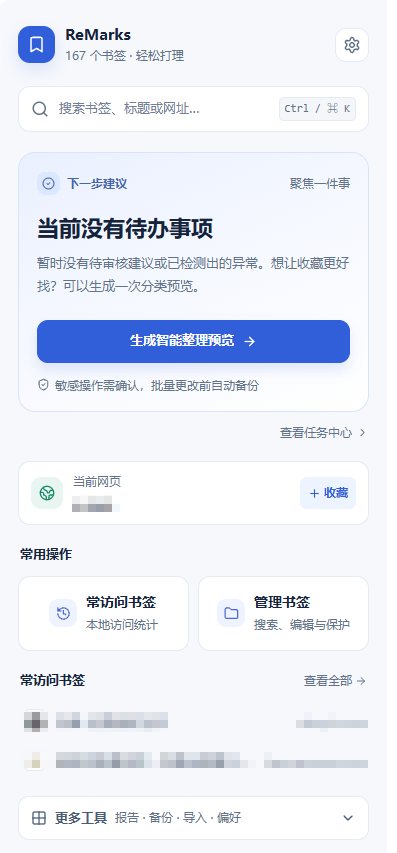 | 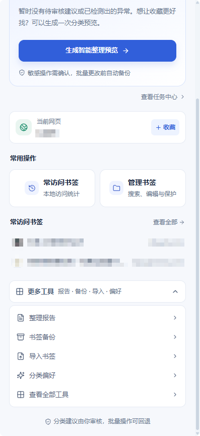 |

| 更多工具页 | 选择书签与本次模型 |
| --- | --- |
| 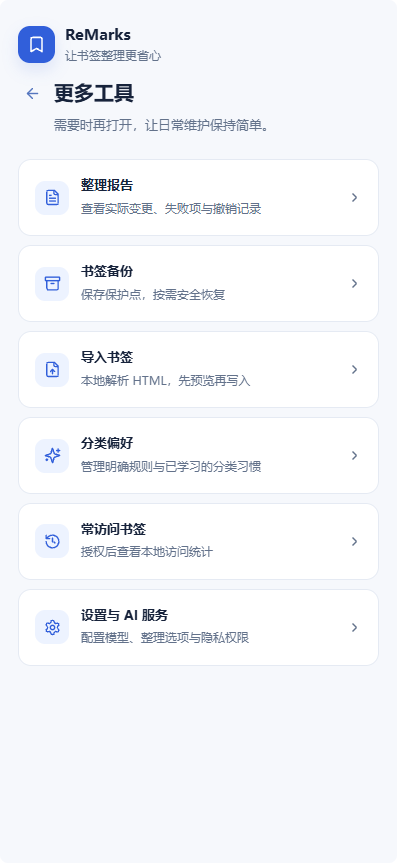 | 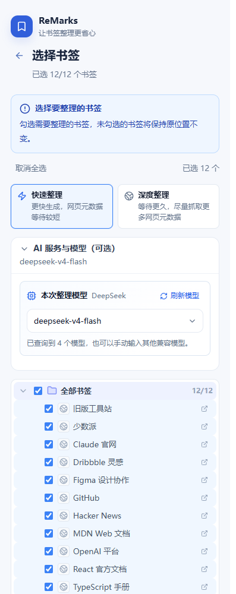 |

| 管理书签与白名单 | 备份与安全恢复 |
| --- | --- |
| 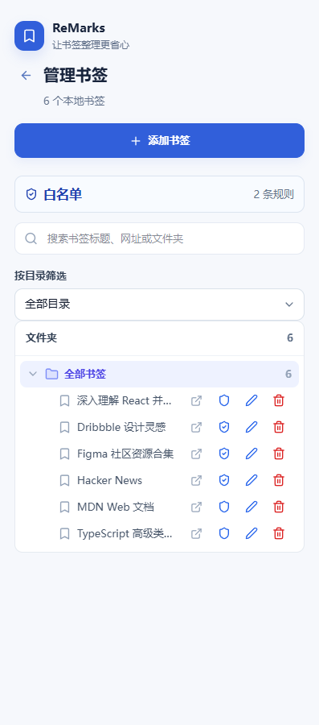 | 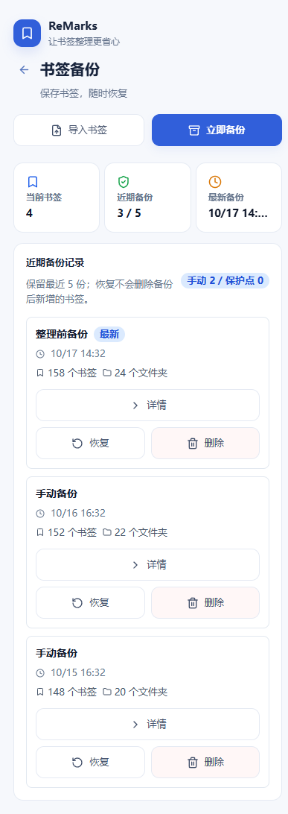 |

<details>
<summary>查看更多：整理报告、分类偏好与日常维护</summary>

| 整理报告 | 分类偏好管理 |
| --- | --- |
| 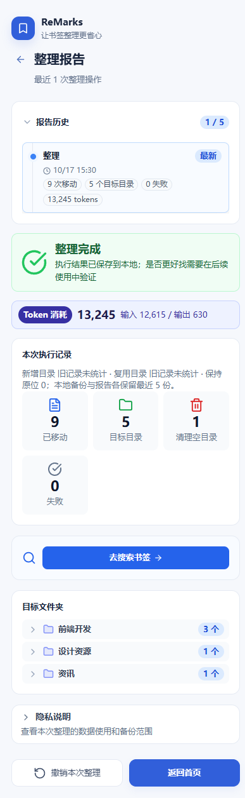 | 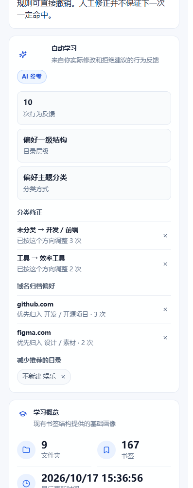 |

| 常访问书签 | 失效链接检测 |
| --- | --- |
| 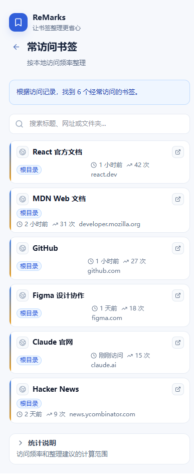 | 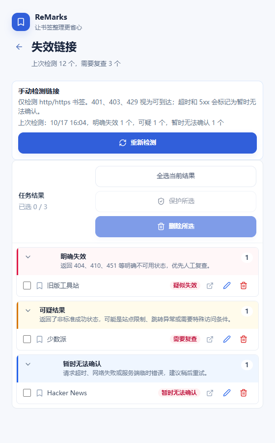 |

</details>

<a id="core-features"></a>

## ✨ 核心能力

### 首次引导与可修正小样本

首次打开时，ReMarks 会在本地统计书签和文件夹。连接 AI 并授权发送数据后，可以抽取最多 20 个书签试分类，检查和修正其中展示的建议；应用前仍会创建备份。没有 API Key 时，也可直接使用本地搜索和重复检查。

### 首页任务中心与工具导航

首页提供下一步建议、当前网页收藏状态和常用工具入口。搜索支持标题、URL、目录和功能印象，可用 `Ctrl / ⌘ K` 唤起；关键词下拉支持键盘选择和编辑保存。授权历史后可在首页查看常访问书签，否则显示最近收藏。

### AI 辅助整理

- 按文件夹选择书签，使用“快速分类”或“更细致地分析网页”生成建议，并可限制分类数量和嵌套层级。
- 支持 OpenAI、DeepSeek、智谱 GLM、Kimi、Gemini、MiniMax、通义千问、豆包及自定义 AI 端点；可选择 Chat Completions 或 Responses 协议。
- 各 Provider 独立保存配置，模型可从列表选择或手动填写；能否调用仍需测试连接。

### 记住我的分类习惯

明确修正建议、手动移动或选择“不推荐这个分类”时，ReMarks 会记录分类修正、域名偏好等反馈，供后续 AI 分类参考；忽略建议不会记录拒绝偏好。可在“分类偏好”页面查看、删除、导入或导出这些记录，也可主动更新书签画像。学习结果不会绕过预览、确认和备份。

### 预览、确认与报告

- 预览展示移动计划、分类原因和模型信号；后者只用于相对排序，并非经过校准的正确率。
- 新增一级目录需先确认结构，待决定的建议可逐条或批量处理；依据不足及疑似清理的条目默认保留原位。也可拖动书签调整目标。
- 确认前不会移动书签；执行前创建备份，逐条移动并记录失败项。最近 5 次整理报告可供查看，最新一次整理支持撤销和重新应用。

### 书签白名单保护

- 在“管理书签”中，可将单个书签或文件夹加入白名单；文件夹保护会覆盖其中现有及后续新增的子项。
- 受保护项目会跳过智能整理、分类推荐、清理删除和链接检测；自动整理也不会将书签移入受保护目录。
- 白名单不影响搜索、打开和完整备份。可在管理页搜索、定位或解除保护；备份恢复时会迁移因恢复而变化的书签 ID，保留对应保护规则。

### 日常书签维护

- 新增书签后生成待处理推荐，可编辑目标分类、接受、忽略或批量处理；“不推荐这个分类”作为独立的明确负反馈。
- 聚合待手动归档、重复链接和失效链接任务；不需要处理的手动归档项可单个或批量忽略。
- 重复检测区分精确重复、忽略 query/hash 后的同路径疑似重复和标题相似疑似重复。
- 失效检测区分明确失效、可疑和暂时无法确认；401、403、429 不会被直接判定为失效。
- 支持搜索、新增、编辑、删除、拖拽移动书签，以及批量清理重复或失效项。
- 可选读取最近 90 天浏览历史，仅在本地统计已收藏 URL 的访问频次。

### 功能印象搜索

忘掉名字也能找回书签。ReMarks 会为书签建立“功能印象索引”，记录它大概是做什么的，而不只是标题和网址。

输入「看视频的网站」或「图片压缩」等描述，即可在本地搜索功能印象、目录、标题和网址，无需调用 AI。没有整理过的书签也可通过内置站点词典和域名特征匹配。


本地搜索没找到时，可点击“帮我找找”或按 `Alt + Enter`，让 AI 联想搜索意图，再对本地召回的候选进行精排。整理和日常操作会积累本地印象索引；也可在管理页分批补全未索引的书签，已完成的批次会保留。索引补全不会修改书签。

### 导入与备份

- 导入浏览器导出的 Netscape bookmarks HTML 文件，先预览，再写入新的导入文件夹。
- 自动跳过重复和无效条目，并保留原始目录层级。
- 整理、导入、恢复、重复删除和失效删除前创建保护点。
- 支持手动备份、查看最近 5 份记录，并展开文件夹详情核对内容；安全恢复前会再次备份当前状态。
- 安全恢复不会删除备份之后新增的书签。

<a id="installation"></a>

## 🚀 安装与体验

### 从 Release 安装

> README 以 `master` 当前源码为准；Release 压缩包对应其版本标签中的代码与发布说明。

### Chrome / Edge

1. 前往 [最新 Release](https://github.com/waangzh/re-bookmarks/releases/latest) 下载 `re-bookmarks-v*.zip`。
2. 解压压缩包。
3. 打开 `chrome://extensions` 或 `edge://extensions`。
4. 开启“开发者模式”，点击“加载已解压的扩展程序”。
5. 选择解压后包含 `manifest.json` 的文件夹。

### Firefox

1. 如果对应 Release 附带 Mozilla 已签名的 `re-bookmarks-firefox-v*.xpi`，在 Firefox 中打开该文件并确认安装。
2. Firefox 140.0 以下不支持此版本。
3. 未签名的 `dist-firefox/` 仅用于开发调试，可在 `about:debugging#/runtime/this-firefox` 临时加载。

签名 XPI 依赖 AMO 凭据；签名、最低版本和回归步骤见 [Firefox 构建、测试与签名](docs/firefox-release.md)。


### 从源码构建

环境要求：

- Node.js 22（与发布工作流一致）
- pnpm 10.25.0
- Chrome、Edge 或 Firefox 140+

```bash
git clone https://github.com/waangzh/re-bookmarks.git
cd re-bookmarks
pnpm install
npm run build:all
```

Chromium 产物在 `dist/`；Firefox 开发产物在 `dist-firefox/`。Firefox 正式安装前还需要 Mozilla 签名，命令见 [Firefox 构建、测试与签名](docs/firefox-release.md)。

<a id="usage"></a>

## 📖 使用流程

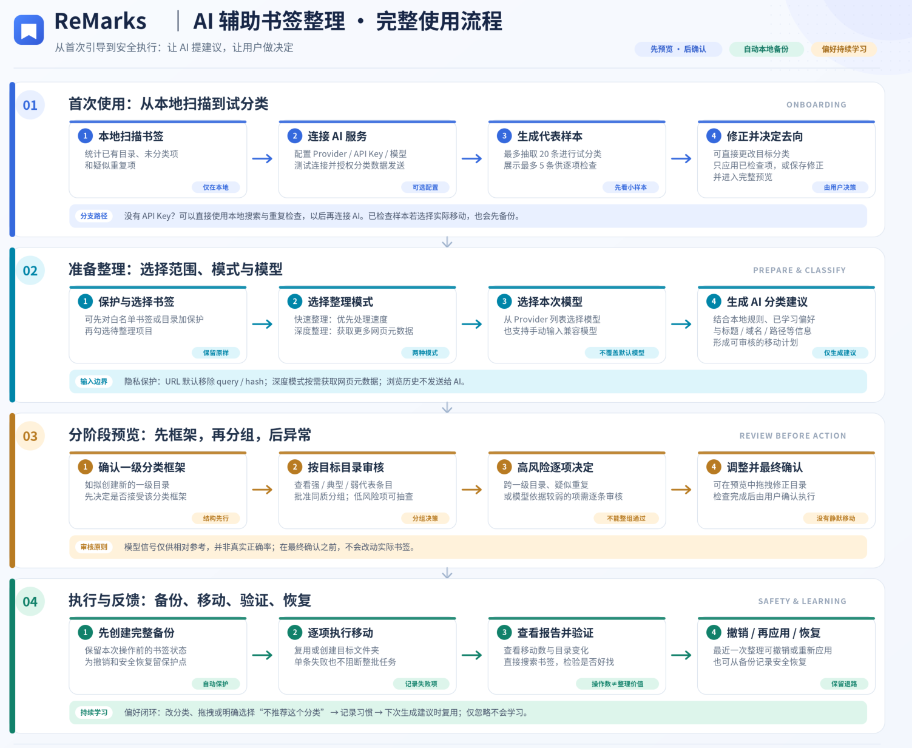

1. **首次使用**：本地扫描书签 → 连接 AI → 生成最多 20 个代表样本，当场修正其中 5 条。没有 API Key 时可直接使用本地搜索与重复检查。

2. **准备整理**：保护需要保持原样的书签或文件夹，选择“快速分类”或“更细致地分析网页”，确认本次模型。本次选择不会覆盖设置页的默认模型。

3. **审核整理方案**：先确认新增一级目录，再逐条或批量处理待决定的建议，并检查实际移动清单。确认前不会改动任何书签。

4. **执行与恢复**：先完整备份，再逐条移动，单项失败不中断整批。之后可查看报告、搜索验证，或撤销、重新应用、从备份安全恢复。

<a id="privacy"></a>

## 🔐 隐私与权限

- 测试 Provider 后，需主动允许发送分类数据；AI 请求可能包含书签信息、目录、分类偏好或网页元数据，具体取决于使用的功能。URL 默认移除 query 和 hash，只有开启“发送完整 URL”后才发送完整网址。请使用你信任的 AI 服务。
- 设置、报告、备份和功能印象索引保存在本地。浏览历史不发送给 AI；常访问书签功能开启时才会请求可选的 `history` 权限。
- 扩展使用书签、存储、当前标签页和侧栏等权限。网站访问权限用于 AI 接口、网页元数据和失效链接检测：Chrome / Edge 安装时授予，Firefox 按需请求。

具体数据和权限说明见[隐私说明](docs/privacy-policy.md)。

## ⚙️ AI Provider

在首次引导或设置页选择 Provider，填写 API Key 和模型并测试连接。支持 OpenAI、DeepSeek、智谱 GLM、Kimi、Gemini、MiniMax、通义千问、豆包，以及兼容 Chat Completions 或 Responses 的自定义服务。模型可从检测结果中选择，也可手动输入。

自定义服务的 Base URL 填接口根地址（通常以 `/v1` 结尾），默认请求路径分别为 `/chat/completions` 或 `/responses`，也可自行调整。[模型列表检测说明](docs/model-discovery.md)

未配置 API Key 时，浏览、管理、导入、备份和本地搜索仍可使用；AI 分类、深度回忆和索引补全需要配置 AI 服务。

<a id="development"></a>

## 🛠️ 本地开发

```bash
# 监听 Chromium 开发构建
npm run dev

# 生成 Chrome / Edge 可加载产物
npm run build

# 生成 Firefox 可加载产物
npm run build:firefox

# 同时构建两个目标
npm run build:all
```

监听构建只覆盖 Chromium；Firefox 调试需重新执行 `npm run build:firefox`，并在浏览器扩展管理页重新加载。项目没有独立的 lint、typecheck 或单元测试脚本；代码变更至少应通过 `npm run build:all`，涉及界面时还应手动检查 360px popup、侧边栏和设置页。

### 技术栈

- Manifest V3
- React 18 + TypeScript
- Vite 6 + Tailwind CSS v4
- Zustand + React Router
- Radix UI + lucide-react
- 书签、存储、权限与可选历史记录 WebExtension API

### 项目结构

```text
src/
  app/
    components/    页面组件：整理、报告、推荐、备份、导入、书签管理等
    hooks/         跨页面复用的交互状态机，例如 AI 深度搜索
    services/      书签、AI、印象搜索、偏好学习、规则、整理、备份、历史和存储等业务逻辑
    store/         Zustand 全局状态
    types.ts       跨模块业务类型
    App.tsx        popup、side panel 与 options 共用路由
  background/      Chromium service worker 与 Firefox background scripts 共用逻辑
  popup/           360px 紧凑页面入口
  sidebar/         Chromium side panel 与 Firefox 原生侧栏入口
  options/         设置页入口
  styles/          Tailwind 入口与全局样式
scripts/           Manifest 后处理与图标生成脚本
public/icons/      扩展图标
manifest.json      Chromium 开发态扩展清单
manifests/firefox.json  Firefox 开发态扩展清单
docs/              隐私说明与 Firefox 构建、测试、签名指南
```

## 📌 当前状态与限制

- AI 建议和失效链接检测可能有误，操作前请检查结果。
- 书签较多时建议按文件夹分批整理。撤销和重新应用仅适用于最近一次整理。
- 报告和备份保存在本地，卸载扩展或清空存储前请确认是否需要保留。


## 🤝 参与贡献

欢迎提交 [Issue](https://github.com/waangzh/re-bookmarks/issues) 或 [Pull Request](https://github.com/waangzh/re-bookmarks/pulls)。

提交代码前请：

1. 从 `master` 创建功能分支。
2. 保持修改范围聚焦，不提交 `dist/`、`.env*`、日志或真实 API Key。
3. 运行 `npm run build:all`。
4. 涉及书签移动、删除、权限或隐私边界时，在 PR 中说明手动验证场景。

## ❤ 感谢

感谢真诚、友善、团结、专业的 [LINUX DO](https://linux.do/latest) 社区。

## 📄 许可证

本项目采用 [MIT 许可证](LICENSE)。
