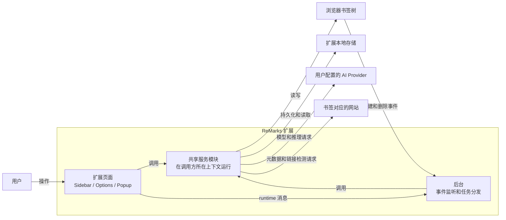

# ReMarks 架构

ReMarks 是面向 Chrome、Edge 和 Firefox 的 Manifest V3 扩展。它在浏览器内读取书签、生成整理建议，并在用户确认后写入浏览器书签树。整个扩展随浏览器安装，ReMarks 自身无需部署服务端。AI 请求从扩展直接发往用户配置的 Provider，网页元数据读取和链接检测则直接访问对应网站。

## 运行边界

- Sidebar、Options 和 Popup 是三个独立的 HTML 构建入口，共用 React 应用和 `HashRouter`。两份清单都把工具栏按钮接到侧栏行为，Popup 仍参与构建。页面和后台各有自己的运行上下文，同一个服务模块可以被不同上下文分别加载。入口见 [App.tsx](src/app/App.tsx)、[Vite 配置](vite.config.ts) 和 [后台入口](src/background/index.ts)。
- 两种目标使用同一份后台源码。后台在模块顶层注册书签事件和 `runtime.onMessage`，它生成或清理待处理推荐、维护 badge、配置侧栏行为，并将预览和链接检测消息交给对应服务。浏览器可以停止空闲后台，任务状态应从持久化记录读取。相关实现见 [后台入口](src/background/index.ts) 和 [预览任务](src/app/services/previewTask.ts)。平台细节见 [Chrome 后台生命周期](https://developer.chrome.com/docs/extensions/develop/concepts/service-workers/lifecycle) 和 [MDN 跨浏览器指南](https://developer.mozilla.org/en-US/docs/Mozilla/Add-ons/WebExtensions/Build_a_cross_browser_extension)。
- 浏览器书签树是书签位置、标题和 URL 的事实来源。`chrome.storage.local` 存储扩展自身的数据，包括设置、保护规则、预览任务、推荐、报告、备份和印象索引。Zustand 聚合当前页面使用的状态，每个页面有独立实例。需要跨页面同步的流程重新读取持久化状态，部分页面通过 `chrome.storage.onChanged` 触发更新。见 [storage.ts](src/app/services/storage.ts)、[useAppStore.ts](src/app/store/useAppStore.ts)、[Preview.tsx](src/app/components/Preview.tsx) 和 [Recommendations.tsx](src/app/components/Recommendations.tsx)。

## 模块职责与依赖方向

页面组件调用 `useAppStore` 或直接调用对应的服务。Store 通过服务加载和保存数据。后台与页面平级，通过消息协作，并直接调用共享服务。服务间可以按业务需要组合，例如 `recommendations` 调用 `organizer` 执行已批准的移动，`organizer` 再调用 `bookmarks` 和 `storage`。共享业务类型集中在 [`types.ts`](src/app/types.ts)。新增业务逻辑时保持服务独立于 React、路由和 Zustand，后台入口只负责事件接入和消息分发。

| 模块 | 负责什么 |
| --- | --- |
| `src/app/components/`、`src/app/hooks/` | 页面交互、表单、确认和结果展示。整理审核、推荐处理和书签管理分别从 `Preview`、`Recommendations`、`ManageBookmarks` 进入。 |
| `src/app/store/` | 聚合设置、书签、推荐和报告，提供页面级加载和刷新入口。见 [useAppStore.ts](src/app/store/useAppStore.ts)。 |
| `organizer`、`previewReview`、`recommendations` | 生成整理计划、计算审核决策、维护待处理推荐，执行已批准的移动并生成报告。见 [organizer.ts](src/app/services/organizer.ts)、[previewReview.ts](src/app/services/previewReview.ts)、[recommendations.ts](src/app/services/recommendations.ts)。 |
| `bookmarks`、`storage`、`backups`、`importBookmarks` | 封装浏览器书签和本地存储操作，提供备份恢复及导入流程。见 [bookmarks.ts](src/app/services/bookmarks.ts)、[storage.ts](src/app/services/storage.ts)、[backups.ts](src/app/services/backups.ts)、[importBookmarks.ts](src/app/services/importBookmarks.ts)。 |
| `rules`、`fixedRules`、`habits`、`whitelist`、`previewSafety`、`preferenceSafety` | 准备 AI 输入、归一化分类路径、维护固定规则和习惯画像，并在生成与执行阶段检查保护范围、明确偏好和计划变化。 |
| `aiProvider`、`pageMetadata`、`hostPermissions`、`history` | 处理 AI 协议、网页元数据读取、网站授权和本地常访问统计。见 [aiProvider.ts](src/app/services/aiProvider.ts)、[hostPermissions.ts](src/app/services/hostPermissions.ts)、[history.ts](src/app/services/history.ts)。 |
| `previewTask`、`bookmarkTasks` | 定义预览和链接扫描消息，管理任务执行、进度和持久化结果。`bookmarkTasks` 也提供重复书签检测。见 [previewTask.ts](src/app/services/previewTask.ts)、[bookmarkTasks.ts](src/app/services/bookmarkTasks.ts)。 |
| `impressionSearch`、`aiImpressionSearch`、`impressionBackfill`、`semanticIndex` | 本地印象搜索、AI 辅助深度搜索和用途补全，以及印象索引的读写。见 [impressionSearch.ts](src/app/services/impressionSearch.ts)、[semanticIndex.ts](src/app/services/semanticIndex.ts)。 |

## 关键流程

### 生成预览与执行整理

1. `Preview` 调用 `startPreviewTask`，记录任务 ID 和选中的书签 ID，并优先通过 `runtime` 将生成任务交给后台。后台复核任务身份和原始选择范围。页面通过持久化状态读取进度与结果。见 [Preview.tsx](src/app/components/Preview.tsx) 和 [previewTask.ts](src/app/services/previewTask.ts)。
2. `generateMovePlanPreviewForBookmarks` 读取书签、设置和规则，过滤受保护对象，按模式准备输入并调用 AI。服务校验分类结果和输入 ID、规范化目录，并将缺失或无效结果降级为可审核的计划。见 [organizer.ts](src/app/services/organizer.ts)、[aiProvider.ts](src/app/services/aiProvider.ts) 和 [rules.ts](src/app/services/rules.ts)。
3. 用户确认后，`executeMovePlans` 先保存执行前备份，再逐项复核最新书签位置、保护和偏好约束。每项记录执行结果，失败项进入报告，其余项继续处理。`undoLastOrganize` 使用备份中的执行记录和当前书签位置判断可撤销的移动。见 [organizer.ts](src/app/services/organizer.ts)。

### 新书签推荐与管理工具

- 新增书签时，后台调用 `createPendingRecommendation`，将结果留在推荐队列。接受推荐时，`acceptRecommendations` 将批准项转换成移动计划并复用 `executeMovePlans`。见 [后台入口](src/background/index.ts) 和 [recommendations.ts](src/app/services/recommendations.ts)。
- 链接检测由用户启动，经 `bookmarkTasks` 发送后台消息并保存扫描报告。网络检测结果供用户判断，删除由页面另行确认。重复项和失效项的批量删除有各自的备份入口，单项管理操作沿用 `ManageBookmarks` 的现有编排。见 [bookmarkTasks.ts](src/app/services/bookmarkTasks.ts) 和 [ManageBookmarks.tsx](src/app/components/ManageBookmarks.tsx)。

## 必须保留的边界

- **用户确认与写入**。AI 建议只有经过审核才能成为可执行操作。新批量写入先展示范围、取得确认并等待备份保存成功。执行时重新检查当前对象和白名单。浏览器书签 API 按项写入，批次可能部分成功。恢复备份另有恢复前保护点和受保护对象的显式处理。见 [organizer.ts](src/app/services/organizer.ts)、[whitelist.ts](src/app/services/whitelist.ts) 和 [backups.ts](src/app/services/backups.ts)。
- **网络与隐私**。AI 入参中的合法 URL 默认去掉 query 和 hash，仅开启 `sendFullUrl` 时发送完整 URL。网页元数据和链接检测请求访问实际书签地址，属于独立的网络边界。API Key 存于扩展本地设置，并用于 Provider 请求认证。浏览历史权限按需申请，访问记录仅用于本地常访问统计。见 [rules.ts](src/app/services/rules.ts)、[pageMetadata.ts](src/app/services/pageMetadata.ts)、[history.ts](src/app/services/history.ts) 和 [隐私政策](docs/privacy-policy.md)。
- **任务状态与生命周期**。预览记录任务 ID、选择范围、进度和白名单指纹，写回时检查任务是否仍有效。取消用的 `AbortController` 只存在于当前执行上下文。页面重开可以读取已有状态，仍在进行的请求可能随后台退出而中断。扩展任务时需明确超时、重开、取消和迟到结果的处理方式。见 [previewTask.ts](src/app/services/previewTask.ts) 和 [Chrome 后台生命周期](https://developer.chrome.com/docs/extensions/develop/concepts/service-workers/lifecycle)。

## 构建目标与平台差异

| 目标 | 源清单 | 后台与侧栏 | 网站权限 | 构建产物 |
| --- | --- | --- | --- | --- |
| Chrome / Edge | [manifest.json](manifest.json) | `background.service_worker`、`side_panel` | `host_permissions` 声明 `<all_urls>` | `npm run build` → `dist/` |
| Firefox | [manifests/firefox.json](manifests/firefox.json) | `background.scripts`、`sidebar_action` | `optional_host_permissions` 声明 `<all_urls>`，由用户手势触发授权 | `npm run build:firefox` → `dist-firefox/` |

Vite 通过 `__REMARKS_BROWSER_TARGET__` 选择目标。构建后由 `copy-manifest.cjs` 写入产物清单、改写入口路径并复制图标。新增浏览器能力时，在源码清单和相应适配入口修改，并用 `npm run build:all` 核对两个产物。权限拒绝和侧栏行为还需在对应浏览器中验证。见 [vite.config.ts](vite.config.ts)、[copy-manifest.cjs](scripts/copy-manifest.cjs) 和 [Chrome 权限声明指南](https://developer.chrome.com/docs/extensions/develop/concepts/declare-permissions)。

## 如何扩展

| 改动目标 | 从哪里开始 |
| --- | --- |
| 新增页面或工具 | 在 `components/` 编写交互，在 `App.tsx` 注册共享路由。复用已有服务，按需通过 Store 聚合数据，并检查 Popup、Sidebar 和 Options 的可用性。 |
| 新增整理规则或批量写入 | 将规则放在对应的服务中，审核状态留在页面，批量整理复用 `executeMovePlans`。新增写入能力应同时覆盖确认、备份、保护变化、部分失败和结果展示。 |
| 扩展 AI Provider | 从 `aiProvider.ts` 的 profile、协议适配和解析入口入手，并核对 `Options` 与 `Onboarding` 共用的 `AIProtocolFields`。复用现有授权、脱敏、响应校验和连接状态失效逻辑。默认模型、默认地址或协议变更需先确认。 |
| 新增后台任务 | 在 `services/` 定义消息、参数校验、任务状态和持久化策略，按需在 `types.ts` 定义共享类型。由 `background/index.ts` 注册分发，页面调用服务并读取结果。 |
| 新增依赖权限的浏览器能力 | 先核对两份 manifest 和目标浏览器 API，按需申请所需权限并处理拒绝或撤销。Firefox 网站权限请求复用 `hostPermissions.ts` 的用户手势入口。 |

## 参考

- 文档结构参考 matklad 的架构写作指南和 C4 的分层视图，覆盖系统边界、模块地图和跨模块约束。[ARCHITECTURE.md 写作指南](https://matklad.github.io/2021/02/06/ARCHITECTURE.md.html) · [C4 图的层级](https://c4model.com/diagrams.html)
- 项目内的操作约定与验证要求见 [AGENTS.md](AGENTS.md)。
